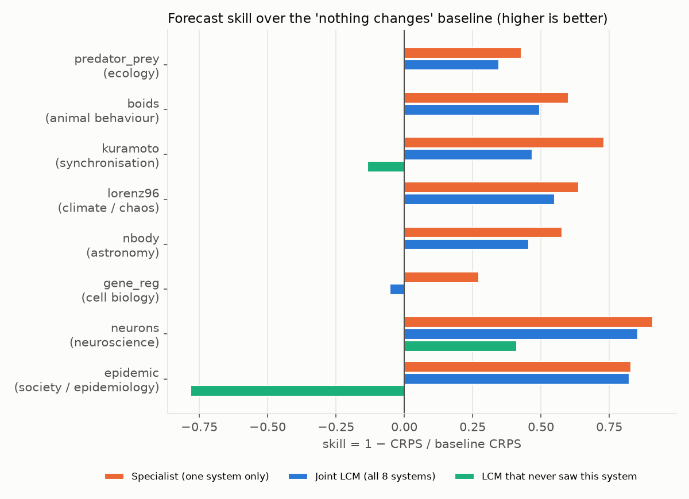
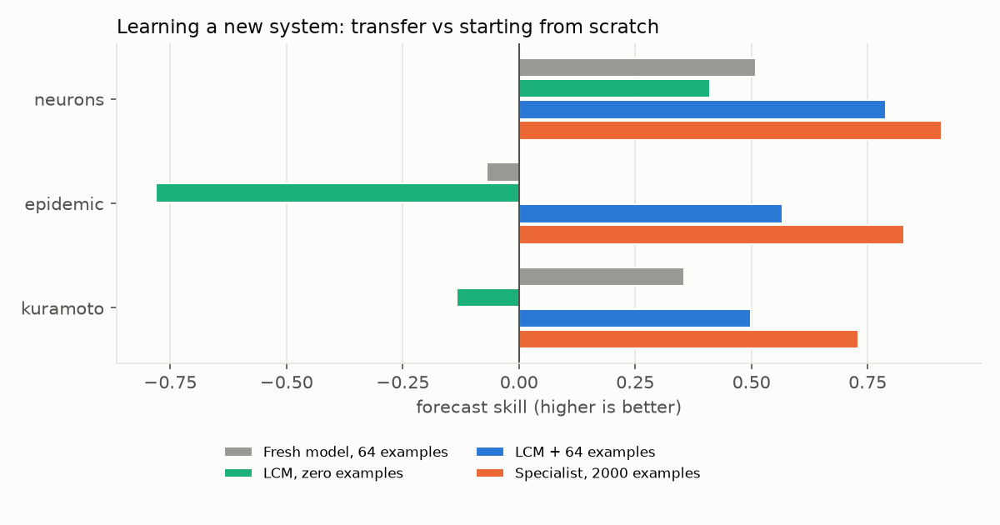
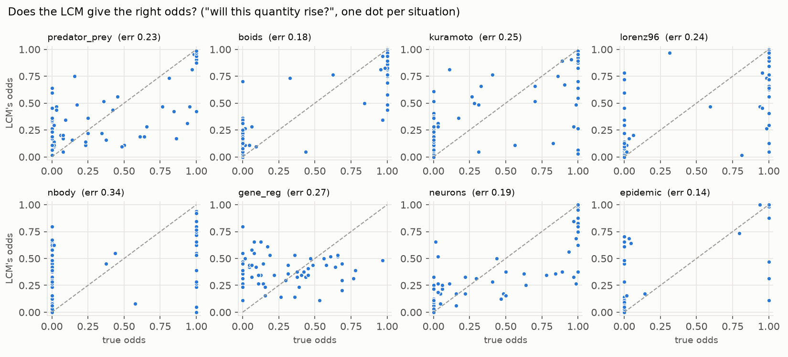
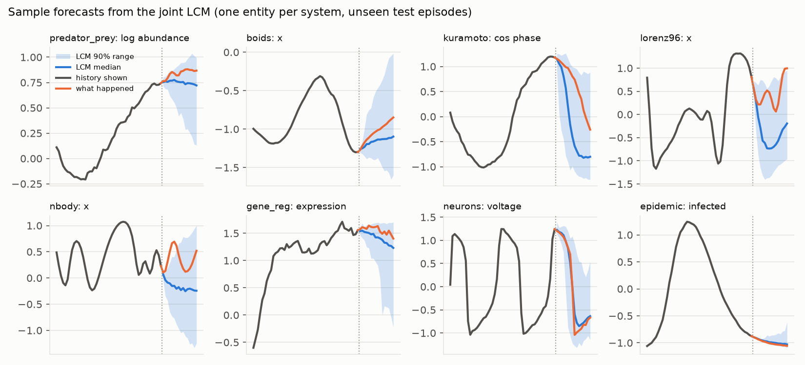

# LCM Phase 0 results

Config: 2000 training episodes per system, 5000 training steps per model, 128 test episodes per system. Numbers are in per-episode normalised units.

## The three questions

1. **Does one model trained on all systems beat specialists?** The joint model beats the specialist on **0 of 8** systems (none), with the same training budget.
2. **Can it forecast a system it has never seen?** Zero-shot it beats the 'nothing changes' baseline on **1 of 3** held-out systems (neurons).
3. **Does prior experience make new systems faster to learn?** With only 64 examples, the pretrained LCM beats a fresh model on **3 of 3** (neurons, epidemic, kuramoto).

Odds: across situations, the joint model's odds are off by **0.23** on average, against 0.40 for an informed guess that always says the system's average odds. The truth lands inside its 90% range **87%** of the time (ideal: 90%).

## Forecast accuracy per system

CRPS scores the whole predicted distribution (lower is better). The baseline repeats the last observation.

| system | field | baseline | specialist | joint LCM | LCM, never saw it | joint 90% coverage |
|---|---|---|---|---|---|---|
| predator_prey | ecology | 0.091 | 0.052 | 0.060 | - | 85% |
| boids | animal behaviour | 0.484 | 0.194 | 0.244 | - | 84% |
| kuramoto | synchronisation | 0.540 | 0.145 | 0.287 | 0.613 | 86% |
| lorenz96 | climate / chaos | 0.763 | 0.276 | 0.344 | - | 80% |
| nbody | astronomy | 0.584 | 0.247 | 0.318 | - | 87% |
| gene_reg | cell biology | 0.073 | 0.053 | 0.077 | - | 93% |
| neurons | neuroscience | 1.097 | 0.099 | 0.159 | 0.645 | 95% |
| epidemic | society / epidemiology | 0.231 | 0.040 | 0.041 | 0.411 | 88% |

## Learning a new system from little data

| held-out system | fresh model, few examples | LCM, zero examples | LCM + few examples | specialist, full data |
|---|---|---|---|---|
| neurons | 0.539 | 0.645 | 0.231 | 0.099 |
| epidemic | 0.247 | 0.411 | 0.100 | 0.040 |
| kuramoto | 0.348 | 0.613 | 0.271 | 0.145 |

## Odds of an outcome

Event: *the key variable of entity 0 ends the forecast window higher than it is now.* True odds come from replaying each situation 64 times in the simulator with fresh randomness. The informed guess knows each system's average odds; the LCM has to work out the odds for each situation.

| system | LCM odds error | informed-guess error |
|---|---|---|
| predator_prey | 0.235 | 0.346 |
| boids | 0.176 | 0.474 |
| kuramoto | 0.246 | 0.436 |
| lorenz96 | 0.243 | 0.481 |
| nbody | 0.343 | 0.437 |
| gene_reg | 0.271 | 0.224 |
| neurons | 0.186 | 0.404 |
| epidemic | 0.143 | 0.367 |
