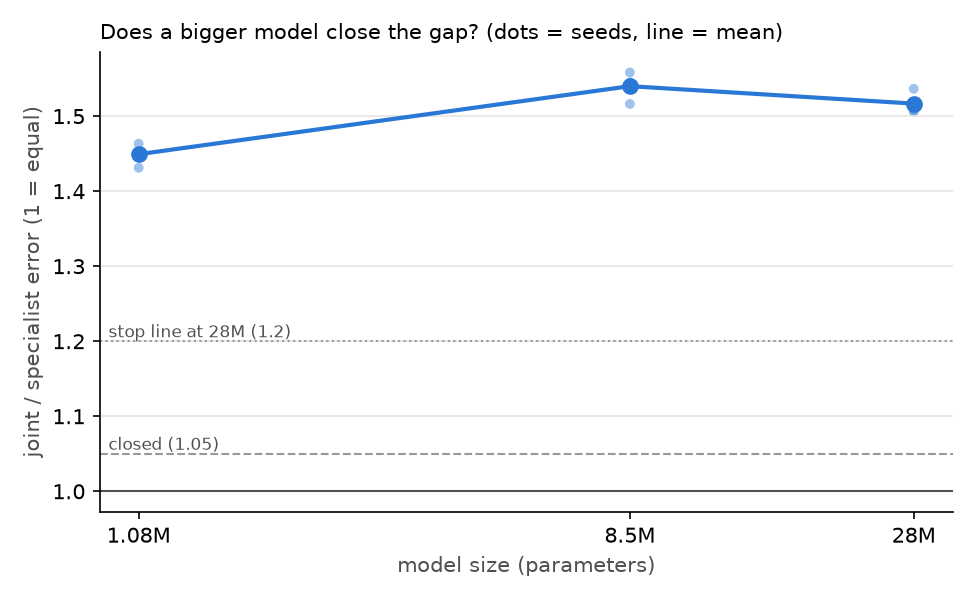

# Stage A scaling report

Results folder: `/home/pjallen5/lcm-runs/stageA_n20k`. Gap = joint / specialist CRPS, geometric mean over 8 systems (1.0 = equal, higher = joint worse). Phase 0 reference gap: 1.34 (different settings, not used for the verdicts).

## Verdicts (criteria fixed before running)

| Check | Result | Detail |
|---|---|---|
| Gap shrinks (8.5M at least 0.10 below 1.08M) | **NO** | 1.449 -> 1.540 (drop -0.091; 2x the seed noise = 0.031) |
| Gap closes (1.05 or less at some size) | **NO** | smallest gap 1.449 |
| Stop and rethink (gap still above 1.2 at 28M) | **YES - STOP** | 28M gap 1.517 |

## Gap by model size

| Size | Seeds complete | Gap mean | sd | Per seed | Runs overfitting* |
|---|---|---|---|---|---|
| 1.08M | 3 of 3 | 1.449 | 0.016 | s0: 1.463, s1: 1.431, s2: 1.453 | 0 of 54 |
| 8.5M | 3 of 3 | 1.540 | 0.022 | s0: 1.558, s1: 1.545, s2: 1.516 | 0 of 54 |
| 28M | 3 of 3 | 1.517 | 0.017 | s0: 1.508, s1: 1.536, s2: 1.506 | 3 of 54 |

*Validation NLL rose more than 0.05 after its best point; the best checkpoint was used anyway.

## Gap per system (mean over seeds)

| System | 1.08M | 8.5M | 28M |
|---|---|---|---|
| predator_prey | 1.18 | 1.32 | 1.26 |
| boids | 1.20 | 1.25 | 1.25 |
| kuramoto | 1.54 | 1.44 | 1.39 |
| lorenz96 | 3.57 | 5.17 | 4.07 |
| nbody | 1.38 | 1.72 | 2.26 |
| gene_reg | 1.15 | 1.08 | 1.06 |
| neurons | 1.25 | 1.20 | 1.16 |
| epidemic | 1.25 | 1.16 | 1.13 |

## Transfer (secondary)

| Size | Zero-shot beats baseline (seeds) | Pretraining advantage, from-scratch / fine-tuned error |
|---|---|---|
| 1.08M | neurons 3/3, epidemic 0/3, kuramoto 0/3 | neurons 2.40x, epidemic 1.70x, kuramoto 1.07x |
| 8.5M | neurons 3/3, epidemic 0/3, kuramoto 0/3 | neurons 1.36x, epidemic 1.69x, kuramoto 1.05x |
| 28M | neurons 3/3, epidemic 0/3, kuramoto 0/3 | neurons 1.18x, epidemic 1.89x, kuramoto 1.02x |

