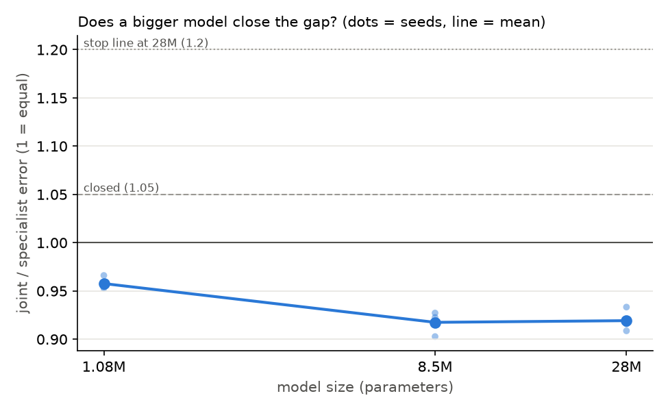

# Stage A scaling report

Joint models from `/home/pjallen5/lcm-runs/stageA_joint160k`; specialists and transfer runs from `/home/pjallen5/lcm-runs/stageA_n20k`. Gap = joint / specialist CRPS, geometric mean over 8 systems (1.0 = equal, higher = joint worse). Phase 0 reference gap: 1.34 (different settings, not used for the verdicts).

## Verdicts (criteria fixed before running)

| Check | Result | Detail |
|---|---|---|
| Gap shrinks (8.5M at least 0.10 below 1.08M) | **NO** | 0.958 -> 0.917 (drop +0.040; 2x the seed noise = 0.017) |
| Gap closes (1.05 or less at some size) | **YES** | at 1.08M, 8.5M, 28M |
| Stop and rethink (gap still above 1.2 at 28M) | **NO** | 28M gap 0.919 |

## Gap by model size

| Size | Seeds complete | Gap mean | sd | Per seed | Runs overfitting* | Gap with the reference run's joint |
|---|---|---|---|---|---|---|
| 1.08M | 3 of 3 | 0.958 | 0.007 | s0: 0.966, s1: 0.954, s2: 0.953 | 0 of 54 | 1.449 |
| 8.5M | 3 of 3 | 0.917 | 0.013 | s0: 0.927, s1: 0.923, s2: 0.903 | 0 of 54 | 1.540 |
| 28M | 3 of 3 | 0.919 | 0.013 | s0: 0.916, s1: 0.933, s2: 0.909 | 3 of 54 | 1.517 |

*Validation NLL rose more than 0.05 after its best point; the best checkpoint was used anyway.

## Gap per system (mean over seeds)

| System | 1.08M | 8.5M | 28M |
|---|---|---|---|
| predator_prey | 0.94 | 0.96 | 0.96 |
| boids | 0.95 | 0.94 | 0.96 |
| kuramoto | 1.03 | 1.00 | 0.98 |
| lorenz96 | 1.29 | 1.01 | 0.97 |
| nbody | 0.88 | 0.67 | 0.70 |
| gene_reg | 1.03 | 1.01 | 1.00 |
| neurons | 0.95 | 0.99 | 0.98 |
| epidemic | 0.71 | 0.83 | 0.87 |

## Transfer (secondary) - from the reference run, unchanged

| Size | Zero-shot beats baseline (seeds) | Pretraining advantage, from-scratch / fine-tuned error |
|---|---|---|
| 1.08M | neurons 3/3, epidemic 0/3, kuramoto 0/3 | neurons 2.40x, epidemic 1.70x, kuramoto 1.07x |
| 8.5M | neurons 3/3, epidemic 0/3, kuramoto 0/3 | neurons 1.36x, epidemic 1.69x, kuramoto 1.05x |
| 28M | neurons 3/3, epidemic 0/3, kuramoto 0/3 | neurons 1.18x, epidemic 1.89x, kuramoto 1.02x |

